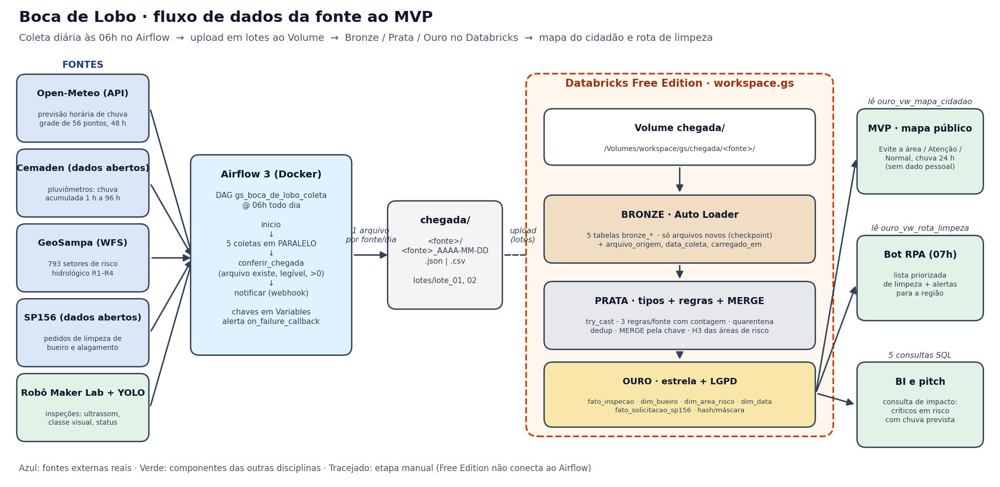

# Boca de Lobo · componente Dados (Big Data Architecture & Data Integration)

> **GS 2026.2 · CitizenTech · Engenharia de Software 4º ano · FIAP**

Antes de cada temporal, um robô inspeciona as bocas de lobo do bairro e descobre quais estão entupidas.
Este repositório é o **pipeline de dados** do produto: coleta a previsão de chuva, os pluviômetros, as áreas
de risco, os pedidos do cidadão e as inspeções do robô; trata tudo em Bronze, Prata e Ouro; e entrega ao
mapa público a resposta para *"onde não passar hoje?"*.

## Integrantes

| Nome completo | RM |
|---|---|
| Açussena Macedo Mautone | 552568 |
| Felipe Heilmann Marques | 551026 |
| Felipe Voidela Toledo | 98595 |
| Carlos Eduardo Caramante Ribeiro | 552159 |
| Ian Cancian Nachtergaele | 98387 |

## Ficha técnica do MVP

| Item | Boca de Lobo |
|---|---|
| Cidadão e território | Morador de bairro que alaga todo verão, principalmente em áreas baixas e periféricas de São Paulo |
| Problema, em uma frase | Bueiro entupido + chuva forte = rua alagada, carro perdido e casa invadida, e ninguém avisa antes |
| Proposta de valor | Saber **antes** da chuva quais bueiros estão entupidos em área de risco: a equipe de limpeza recebe a rota priorizada, e o morador sabe onde não passar |
| Componentes | Robô (Maker Lab) · YOLO (Visão) · RAG da Defesa Civil (GenAI) · **pipeline de dados (este repo)** · bot de alertas (RPA) · mapa público com observabilidade (DevOps) · modelo de negócio (BI) |
| Fontes de dados | Open-Meteo, Cemaden, GeoSampa, SP156 e inspeções do robô (ver tabela abaixo) |
| Modelos de IA | Classificador embarcado livre/atenção/crítico (ultrassom) e YOLO com 4 classes de bueiro |
| URL do MVP e repositório | Mapa do cidadão: **https://felipevoidela.github.io/GS2-2026-Big-Data-Architecture/** (GitHub Pages da pasta `mvp/`, lendo o export da Ouro) · Repositório: https://github.com/FelipeVoidela/GS2-2026-Big-Data-Architecture |
| Indicadores de impacto | Pontos críticos em área de risco com chuva prevista; moradias e pessoas nessas áreas; tempo de espera no SP156 |
| ODS | 11 (cidades resilientes), 13 (adaptação ao clima), 3 (saúde, doenças de veiculação hídrica) |

## Arquitetura



```
Fontes ──► Airflow (06h, 5 coletas em paralelo) ──► chegada/<fonte>/<fonte>_AAAA-MM-DD.*
        ──► upload em lotes pela interface ──► Volume workspace.gs.chegada
        ──► BRONZE (Auto Loader) ──► PRATA (regras + MERGE) ──► OURO (estrela + LGPD)
        ──► ouro_vw_mapa_cidadao (MVP)  ·  ouro_vw_rota_limpeza (RPA)  ·  5 consultas SQL (BI)
```

O Databricks Free Edition não se conecta ao Airflow: os arquivos de `chegada/` sobem ao Volume **pela interface**.

### Fontes

| Fonte | Tipo | Origem | Formato | Frequência | O que traz |
|---|---|---|---|---|---|
| Open-Meteo | **API pública externa** | `api.open-meteo.com/v1/forecast` | JSON (array) | diária, 06h | chuva horária e probabilidade, 48 h, grade de 56 pontos (0,1°) sobre SP |
| Cemaden | **dado aberto externo** | `resources.cemaden.gov.br/.../getJson2.php?uf=SP` | JSON (array) | diária, 06h | chuva acumulada 1 h a 96 h dos 724 pluviômetros de SP (79 na capital) |
| GeoSampa | **WFS público da prefeitura** | camada `geoportal:risco_hidrologico` | GeoJSON → JSON Lines | diária, 06h | 793 setores de risco de enchente/alagamento, grau R1–R4, nº de moradias |
| SP156 | **dado aberto da prefeitura** | `dados.prefeitura.sp.gov.br` (CKAN, arquivo trimestral mais recente) | CSV | diária, 06h (arquivo em cache por trimestre) | ~10,7 mil pedidos de drenagem (limpeza de bueiro, alagamento, galeria) |
| Robô | interno, **simulado** | `dags/boca_de_lobo/simulador_robo.py` | JSON Lines | diária, 06h | ~200 inspeções/dia: ultrassom, classe YOLO, status da IA embarcada |

**Dados simulados (justificativa):** o robô e o YOLO ainda estão sendo construídos por Maker Lab e Visão. O
simulador gera exatamente o JSON que o robô vai enviar, sobre **300 pontos reais** (endereços de pedidos de
limpeza de boca de lobo do SP156, 60% perto de área de risco), com acúmulo de lixo realista (dente de serra),
classificação pela mesma regra da IA embarcada e **~6% de defeitos propositais** (leitura nula, ultrassom fora
da faixa, confiança > 1, classe desconhecida, GPS zerado, reenvio duplicado) para exercitar as regras da Prata.
É determinístico por data, então a coleta é idempotente. Operadores são fictícios. Quando o robô estiver no ar,
só a função `coletar_inspecoes` muda.

## Estrutura do repositório

```
dags/                         DAG do Airflow e pacote de coleta
  gs_boca_de_lobo_coleta.py   inicio >> [5 coletas] >> conferir_chegada >> notificar
  boca_de_lobo/               config, fontes (coletas), simulador do robô, ref/bueiros_piloto.csv
databricks/                   notebooks (formato source do Databricks) e SQL
  00_setup.py                 schema, volume, pastas, sal LGPD, tabelas de controle
  01_bronze_autoloader.py     Auto Loader incremental + contagens antes/depois
  02_prata.py                 tipos, 3 regras de qualidade por fonte, quarentena, MERGE, H3
  03_ouro.py                  dimensões, fatos, LGPD, views do MVP, exportação
  04_consultas_mvp.sql        as 5 consultas (1 de impacto)
amostras/                     um pouco de cada fonte (SP156 com número e CEP mascarados)
mvp/                          tela do cidadão (Leaflet) que lê o export de ouro_vw_mapa_cidadao
scripts/                      lotes, amostras, prévia local da Ouro, diagrama
docs/                         diagrama e prints
relatorio/                    relatório (.docx gerado por scripts/gerar_relatorio.py; o PDF vai no Teams)
docker-compose.yaml           Airflow 3.3.2 local (LocalExecutor + Postgres)
```

## Como reproduzir

### 1. Airflow (coleta)

Pré-requisito: Docker Desktop.

```bash
cp .env.example .env          # Windows: copy .env.example .env  (gere a FERNET_KEY e troque as senhas no arquivo)
docker compose up airflow-init
docker compose up -d
```

Abra `http://localhost:8080` (ou a `AIRFLOW_PORT` do `.env`), entre com o usuário do `.env` e ative o DAG
`gs_boca_de_lobo_coleta`. Ele roda sozinho todo dia às 06h e, em ~20 s, grava os 5 arquivos do dia em `chegada/`.
Para testar na hora, clique em **Acionar**: a execução manual gera os mesmos arquivos, mas sobrescreve os do dia
com o retrato daquela hora, por isso os lotes enviados ao Databricks usam só execuções agendadas (ver *Limitações*).

**Variables (Admin → Variables), todas opcionais:**

| Variable | Para quê |
|---|---|
| `gs_alerta_webhook_url` | webhook do Teams/Slack/Discord que recebe o resumo da coleta e o alerta de falha |
| `gs_open_meteo_apikey` | chave do plano comercial do Open-Meteo (sem ela, usa a API pública gratuita) |

Nenhuma chave está no código. Se uma fonte cai, a tarefa tenta de novo 2 vezes, dispara `on_failure_callback`
(webhook) e a execução fica **vermelha**: `notificar` falha de propósito quando a conferência não passou, para não haver falha silenciosa.

### 2. Lotes para o Databricks

Deixe o DAG ligado: cada execução agendada das 06h gera os arquivos de um dia. Monte um lote por dia de coleta:

```bash
python scripts/montar_lotes.py --lote 1 --datas 2026-11-07
python scripts/montar_lotes.py --lote 2 --datas 2026-11-08
```

### 3. Databricks Free Edition

1. **Workspace → Import** os arquivos de `databricks/` (são notebooks em formato *source*).
2. Rode `00_setup.py` uma vez.
3. **Lote 1:** Catalog → `workspace` → `gs` → Volumes → `chegada` → em cada pasta de fonte, *Upload to this volume*
   com os arquivos de `lotes/lote_01/<fonte>/`. Rode `01_bronze_autoloader.py` e `02_prata.py`.
4. **Lote 2:** suba `lotes/lote_02/` do mesmo jeito. Rode `01` de novo (só os arquivos novos entram).
5. Rode `01` **mais uma vez sem subir nada**: a tabela de contagens mostra 0 linhas inseridas (não duplica).
6. Rode `02_prata.py`, `03_ouro.py` e `04_consultas_mvp.sql`.

### 4. MVP

`03_ouro.py` grava `/Volumes/workspace/gs/chegada/_mvp/mapa_cidadao.json`. Baixe e coloque em `mvp/dados/`:

```bash
python -m http.server 8000 -d mvp
```

Abra `http://localhost:8000`. Para desenvolver a tela antes do lakehouse ficar pronto, `python scripts/preview_local.py`
gera o mesmo JSON a partir de `chegada/` com as mesmas regras (requer `pip install -r requirements.txt`).

**Versão pública:** a mesma tela está no ar em **https://felipevoidela.github.io/GS2-2026-Big-Data-Architecture/**
(GitHub Pages servindo o branch `gh-pages`, que é a pasta `mvp/`). Para atualizar depois de um novo export da Ouro:

```bash
git subtree push --prefix mvp origin gh-pages
```

O deploy definitivo do MVP, com container, pipeline e monitoramento, é o componente da disciplina de DevOps.

## Onde cada requisito está

| Req. | Onde |
|---|---|
| 01 · 2+ fontes, 1+ externa | 5 fontes, 4 externas reais (tabela acima) |
| 02 · DAG agendado grava em `chegada/` com data no nome | `dags/gs_boca_de_lobo_coleta.py` (`0 6 * * *`), `config.arquivo_destino` |
| 03 · 2+ tarefas paralelas, conferência, chaves em Variables | 5 coletas paralelas, `conferir_chegada`, `fontes._variable` |
| 04 · 2+ lotes de dias diferentes | `scripts/montar_lotes.py`, prints do Volume |
| 05 · Bronze incremental sem duplicar | `01_bronze_autoloader.py` + `controle_cargas` |
| 06 · Prata: tipos, nulos, MERGE, 3 regras com contagem | `02_prata.py` + `qualidade_regras` + `prata_quarentena` |
| 07 · Ouro: 1 fato + 2 dimensões, 5 consultas | `03_ouro.py`, `04_consultas_mvp.sql` |
| 08 · LGPD na Ouro e tela do MVP | hash com sal, faixa de numeração, CEP mascarado; `ouro_vw_mapa_cidadao` → `mvp/` |
| 09 · README | este arquivo |

## LGPD

| Dado | Bronze/Prata (acesso restrito) | Ouro (o que é consumido) |
|---|---|---|
| Nome, matrícula e e-mail do operador do robô (fictícios) | em claro | `operador_hash` = SHA-256(sal + matrícula + e-mail) |
| Protocolo do pedido SP156 | hash do registro | SHA-256(sal + id) |
| Número da casa (SP156) | em claro (dado aberto) | faixa: `1800-1899` |
| CEP (SP156) | 8 dígitos | `05409-***` |
| Coordenada do pedido (SP156) | 7 casas decimais | 3 casas (~110 m: a rua, não a casa) |

O sal fica no *secret scope* `gs/sal_lgpd` ou na tabela `workspace.gs.config_lgpd`, gerado dentro do Databricks,
nunca no repositório. O mapa público lê **só** `ouro_vw_mapa_cidadao`, que não tem nenhum dado pessoal.
O repositório não tem chaves, senhas nem dados pessoais reais (`.env`, `chegada/` e `lotes/` estão no `.gitignore`).

## Limitações conhecidas

* Os pluviômetros do Cemaden no endpoint público não trazem coordenadas, então a chuva observada entra como média
  da capital (indicador de solo encharcado). Com o token da API PED do Cemaden dá para ligar cada estação ao bairro.
* O SP156 aberto é trimestral: o pipeline sempre pega o arquivo mais recente, que pode ter até 3 meses de atraso.
* Cemaden, GeoSampa e SP156 são o retrato do momento da coleta: por isso os lotes usam só execuções agendadas de dias
  diferentes, nunca execuções manuais com data lógica no passado (que trariam o retrato de hoje com a data de ontem no nome).
